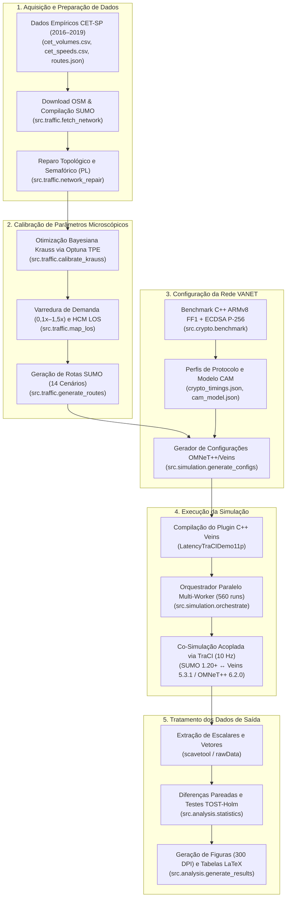

# Relatório de Arquitetura do Pipeline Experimental de Simulação VANET

Este documento descreve de forma modular, matemática e quantitativa a arquitetura do pipeline experimental desenvolvido na **Escola Politécnica da Universidade de São Paulo (POLI-USP)** para a avaliação do impacto computacional e de canal físico da criptografia preservadora de formato **NIST SP 800-38G FF1** (*Format-Preserving Encryption* — FPE) [Dworkin, 2019] sobre mensagens cooperativas **ETSI CAM** (*Cooperative Awareness Messages*) [ETSI EN 302 637-2] em redes veiculares (*Vehicular Ad-Hoc Networks* — VANETs).

O pipeline é orquestrado fim a fim pelo módulo mestre [pipeline.py](/src/pipeline.py) (acionado via [run_pipeline.py](/run_pipeline.py)) e estruturado em cinco módulos sequenciais desacoplados por contratos estritos em JSON e XML.

---

## Matriz Experimental de Simulações

O planejamento fatorial completo do experimento abrange **56 configurações únicas**, cada uma executada sob **$S = 10$ sementes pseudoaleatórias independentes** (`seed-set = 0..9`), totalizando **560 execuções de co-simulação acoplada** ($\text{SUMO} \leftrightarrow \text{Veins/OMNeT++}$):

$$N_{\text{runs}} = \underbrace{\left(6_{\text{highway}} + 4_{\text{urbanRoad}} + 4_{\text{intersection}}\right)}_{14\text{ cenários de tráfego (LOS)}} \times \underbrace{4}_{\text{protocolos}} \times \underbrace{10}_{\text{seeds}} = 56 \times 10 = 560\text{ simulações}$$

### Detalhamento dos 14 Cenários de Tráfego e Matriz Fatorial

| Topologia | Corredor Viário (São Paulo, SP) | ID do Cenário | Nível de Serviço (HCM LOS) | Fator de Demanda ($f_d$) | Veículos Ativos Simultâneos ( Faixa ) | Velocidade Média Espacial ($\text{m/s}$) | CBR Médio no Canal (%) | Protocolos Avaliados ($\times 10$ *seeds* cada) | Total de Execuções |
| :--- | :--- | :---: | :---: | :---: | :---: | :---: | :---: | :--- | :---: |
| **`highway`** | Av. 23 de Maio *(Vd. Brig. Luís Antônio $\leftrightarrow$ Vd. Paraíso, $2.498\text{ m}$)* | `s015` `s030` `s040` `s055` `s075` `s100` | **LOS A** **LOS B** **LOS C** **LOS D** **LOS E** **LOS F** *(Pico CET)* | $0,15\times$ $0,30\times$ $0,40\times$ $0,55\times$ $0,75\times$ $1,00\times$ | $308 \to 2.008$ | $11,2 \to 9,9$ *(40,3 $\to$ 35,6 km/h)* | $2,9\% \to 20,4\%$ | `baseline`, `FF1_AES`, `FF1_LEA`, `FF1_SPECK` | $6 \times 4 \times 10 = \mathbf{240}$ |
| **`urbanRoad`** | R. da Consolação *(Av. Paulista $\leftrightarrow$ R. Rêgo Freitas, $1.922\text{ m}$)* | `s045` `s095` `s100` `s120` | **LOS C** **LOS D** **LOS E** *(Pico CET)* **LOS F** *(Saturado)* | $0,45\times$ $0,95\times$ $1,00\times$ $1,20\times$ | $281 \to 746$ | $7,3 \to 6,1$ *(26,3 $\to$ 22,0 km/h)* | $4,7\% \to 13,1\%$ | `baseline`, `FF1_AES`, `FF1_LEA`, `FF1_SPECK` | $4 \times 4 \times 10 = \mathbf{160}$ |
| **`intersection`** | Av. Nove de Julho ($1.351\text{ m}$) $\times$ Av. São Gabriel ($905\text{ m}$) | `s020` `s050` `s070` `s100` | **LOS A** **LOS B** **LOS C** **LOS F** *(Pico CET)* | $0,20\times$ $0,50\times$ $0,70\times$ $1,00\times$ | $104 \to 485$ | $6,4 \to 4,5$ *(23,0 $\to$ 16,2 km/h)* | $1,4\% \to 6,9\%$ | `baseline`, `FF1_AES`, `FF1_LEA`, `FF1_SPECK` | $4 \times 4 \times 10 = \mathbf{160}$ |
| **Total Global** | **3 Topologias Reais Calibradas** | **14 Níveis** | **LOS A a F** | **$0,15\times$ a $1,20\times$** | **$104 \to 2.008$** | **$4,5 \to 11,2\text{ m/s}$** | **$1,4\% \to 20,4\%$** | **4 Protocolos** | **560 Execuções** |

---

## 1. Aquisição e Preparação de Dados

O primeiro módulo constrói a base cartográfica e empírica de tráfego a partir de levantamentos oficiais da Companhia de Engenharia de Tráfego de São Paulo (**CET-SP**) [CET-SP, 2016–2019] e da malha viária georreferenciada do **OpenStreetMap (OSM)**.

### 1.1 Fontes de Dados Empíricos e Conversão em Equivalente-Passeio (PCE)
Os dados de tráfego provêm das edições de **2016, 2017, 2018 e 2019** do relatório anual *Mobilidade no Sistema Viário Principal — Volumes e Velocidades* (MSVP) da CET-SP [CET-SP, 2016–2019], tabulados em [cet_volumes.csv](/data/cet_volumes.csv) e [cet_speeds.csv](/data/cet_speeds.csv) nas faixas horárias dos picos da manhã ($\mathcal{H}_{\text{manhã}} = \{7, 8, 9\}\text{ h}$) e da tarde ($\mathcal{H}_{\text{tarde}} = \{17, 18, 19\}\text{ h}$):

1. **Conversão para Unidades de Carro de Passeio (*Passenger Car Equivalents* — PCE):** Como o modelo microscópico calibra um fluxo homogêneo equivalente de automóveis, a função [`passenger_car_equivalent`](/src/traffic/cet_data.py#L27-L29) pondera as contagens horárias classificadas por categoria veicular $c \in \mathcal{C}$ segundo os fatores de equivalência $\alpha_c$ definidos em [calibration_params.json](/config/calibration_params.json#L3-L10) [TRB, 2016]:
   $$Q_{\text{PCE}}(r, a, h) = \sum_{c \in \mathcal{C}} \alpha_c \cdot N_c(r, a, h) = 1,0 \cdot N_{\text{auto}} + 1,5 \cdot \left(N_{\text{ônibus\_urb}} + N_{\text{ônibus\_fret}} + N_{\text{caminhões}}\right) + 0,4 \cdot N_{\text{motos}} + 0,0 \cdot N_{\text{bicicletas}} \quad [\text{veíc-eq/h}]$$
2. **Velocidade Média Espacial (*Space-Mean Speed*):** Coletada em campo pela CET-SP via veículos-teste instrumentados com GPS imersos na corrente de tráfego (*floating car method*), calculada pela razão harmônica entre a extensão aferida do corredor $L_r$ e o tempo médio de travessia $\bar{t}_{\text{viagem}}(r, a, h)$:
   $$\bar{v}_{\text{CET}}(r, a, h) = \frac{L_r}{\bar{t}_{\text{viagem}}(r, a, h)} \times 3,6 \quad [\text{km/h}]$$

### 1.2 Caracterização Geográfica dos Corredores ([routes.json](/data/routes.json))

| Topologia | Rota (`route_id`) | Sentido e Trecho de Medição | Ponto de Contagem de Volume | Extensão ($L_r$) | Tipo de Demanda | Coordenadas Extremas (`[lat, lon]`) |
| :--- | :--- | :--- | :--- | :---: | :---: | :--- |
| **`highway`** | `highway_centro` `highway_bairro` | **Centro:** Vd. Paraíso $\to$ Vd. Brig. Luís Antônio **Bairro:** Vd. Brig. Luís Antônio $\to$ Vd. Paraíso | Viaduto Beneficência Portuguesa `[-23.568600, -46.640800]` | $2.498\text{ m}$ $2.498\text{ m}$ | Observada (`cet_volume`) | `[-23.573494, -46.640869]` $\leftrightarrow$ `[-23.551790, -46.637157]` |
| **`urbanRoad`** | `urban_road_centro` `urban_road_bairro` | **Centro:** Av. Paulista $\to$ R. Rêgo Freitas **Bairro:** R. Rêgo Freitas $\to$ Av. Paulista | R. Caio Prado – R. Marquês de Paranaguá | $1.922\text{ m}$ $1.922\text{ m}$ | Observada (`cet_volume`) | `[-23.555657, -46.662785]` $\leftrightarrow$ `[-23.547337, -46.646932]` |
| **`intersection`** *(Via Principal)* | `intersection_main_centro` `intersection_main_bairro` | **Centro:** Av. Cidade Jardim $\to$ Av. São Gabriel **Bairro:** Av. São Gabriel $\to$ Av. Cidade Jardim | Av. Nove de Julho (R. Manuel Guedes – R. Emanuel Kant) | $1.351\text{ m}$ $1.351\text{ m}$ | Observada (`cet_volume`) | `[-23.580605, -46.683614]` $\leftrightarrow$ `[-23.577005, -46.671309]` |
| **`intersection`** *(Via Transversal)* | `intersection_cross_centro` `intersection_cross_bairro` | **Centro:** Av. Antônio J. M. Andrade $\to$ Av. Nove de Julho **Bairro:** Av. Nove de Julho $\to$ Av. Antônio J. M. Andrade | Sem contagem direta na MSVP *(inferido via velocidade)* | $907\text{ m}$ $902\text{ m}$ | Inferida (`speed_bisection`) | `[-23.585342, -46.670215]` $\leftrightarrow$ `[-23.577005, -46.671309]` |

### 1.3 Extração Cartográfica e Compilação da Rede Viária ([fetch_network.py](/src/traffic/fetch_network.py))
1. **Cálculo Esférico das *Bounding Boxes* ([`calculate_route_bboxes`](/src/traffic/fetch_network.py#L61-L78)):** Para cada topologia, dado o conjunto de coordenadas $(\phi_i, \lambda_i)$ das rotas e a margem cartográfica $M_{\text{km}} = 0,4\text{ km}$ (`network.map_margin_km`), as margens angulares em graus decimais são calculadas sobre o elipsoide terrestre aproximado em torno da latitude central $\bar{\phi} = \frac{\phi_{\min} + \phi_{\max}}{2}$:
   $$\Delta \phi = \frac{M_{\text{km}}}{110,574\text{ km/grau}}, \qquad \Delta \lambda = \frac{M_{\text{km}}}{111,320\text{ km/grau} \cdot \max\!\big(\cos(\bar{\phi}\,\pi/180),\; 0,1\big)}$$
2. **Download via Overpass API e Compilação `netconvert`:** [`download_osm_map`](/src/traffic/fetch_network.py#L81-L115) extrai o subgrafo viário (`way["highway"]`) e o utilitário `netconvert` do SUMO [Lopez et al., 2018] compila `osmFiles/<topology>.net.xml`, aplicando validação de erro máximo de comprimento de rota de $15\%$ (`max_length_ratio_error = 0.15` em relação a $L_r$).

### 1.4 Reparo Topológico e Otimização Linear Semafórica ([network_repair.py](/src/traffic/network_repair.py))
Para corrigir artefatos de conversão do OSM para a realidade operacional de São Paulo, são aplicadas quatro transformações idempotentes:
1. **Poda de Arestas Curtas (*Stub Edge Pruning*):** Arestas de extremidade com extensão $< 20\text{ m}$ geradas por `--junctions.join` são removidas para viabilizar a inserção de veículos padrão de $5,0\text{ m}$ sem bloqueio de *depart*.
2. **Restauração de Faixas Diretas Compartilhadas ([`repair_through_lanes`](/src/traffic/network_repair.py#L62-L98)):** Em toda transição de arestas $(e_{\text{in}} \to e_{\text{out}})$ da rota onde o número de conexões diretas que alcançam o final do corredor é inferior a $L_{\text{req}} = \min\!\big(\text{faixas}(e_{\text{in}}),\; \text{faixas\_úteis}(e_{\text{out}})\big)$, as faixas à direita são reconectadas como faixas compartilhadas de movimento direto (corrigindo 7 junções em `urbanRoad` e 5 em `intersection`).
3. **Programação Linear (PL) para Tempo de Verde Semafórico (`repair_traffic_lights`):** Como o `netconvert` divide o ciclo padrão ($C = 90\text{ s}$) igualmente entre todas as fases (resultando em apenas $15\%\text{ a }28\%$ de verde para a via arterial), formula-se um problema de Programação Linear resolvido via `scipy.optimize.linprog` para determinar as novas durações das fases verdes $\mathbf{g} = [g_1, \dots, g_P]^T$ que minimizam a perturbação $L_1$ em relação ao plano original $\mathbf{g}^{(0)}$:
   $$\min_{\mathbf{g}, \, \mathbf{u}} \sum_{p \in \mathcal{P}_{\text{green}}} u_p \quad \text{sujeito a:} \quad \begin{cases} -u_p \le g_p - g_p^{(0)} \le u_p, & \forall p \in \mathcal{P}_{\text{green}} \\ \sum_{p \in \mathcal{P}_{\text{green}}} g_p = C - \sum_{q \notin \mathcal{P}_{\text{green}}} g_q^{(0)} & \text{(invariância do ciclo } C\text{)} \\ \sum_{p \in \mathcal{P}_{d}} g_p \ge \gamma_{\min} \cdot C, & \forall d \in \mathcal{D}_{\text{CET}} \quad (\gamma_{\min} = 0,55) \\ g_p \ge \min\!\big(g_{\text{other},\min},\; g_p^{(0)}\big), & \forall p \in \mathcal{P}_{\text{green}} \quad (g_{\text{other},\min} = 10\text{ s}) \end{cases}$$
   Caso o politopo primal seja infactível (ex.: cruzamento entre duas arteriais concorrentes), o solver resolve um PL secundário do tipo *max-min* ($\max z \text{ s.a. } \sum_{p \in \mathcal{P}_d} g_p \ge z, \; \forall d \in \mathcal{D}_{\text{CET}}$) para equalizar a capacidade das vias principais.
4. **Unificação de Nós Adjacentes (`join_nodes`):** Na Av. Nove de Julho, os nós OSM `1389167160` (R. Alemanha) e `1389167162` (R. Turquia), distantes apenas $33\text{ m}$, são fundidos em um único controlador semafórico lógico.

> [!NOTE]
> **Contrato de Saída do Módulo 1:** Redes viárias compiladas e reparadas em `osmFiles/<topology>.net.xml` e o manifesto de rotas e alças mapeadas em `config/cet_scenarios.json`.

---

## 2. Calibração de Parâmetros Microscópicos

O segundo módulo calibra o modelo microscópico de seguimento veicular (*car-following*) do **Eclipse SUMO** [Lopez et al., 2018] frente às velocidades empíricas da CET-SP seguindo o protocolo metodológico de *Khaleghian et al. (SMARTCOMP 2023)* [Khaleghian et al., 2023] e mapeia os regimes de tráfego segundo o *Highway Capacity Manual* (**HCM**) [TRB, 2016; TRB, 2022].

### 2.1 Formulação Matemática do Modelo de Seguimento de Krauss
No modelo estocástico de colisão-livre de **Krauss** [Krauss, 1998], atualizado a cada passo discreto $\Delta t = 0,1\text{ s}$, a velocidade segura $v_{\text{safe}}(t)$ de um veículo seguidor com velocidade $v_f(t)$ a uma distância líquida (*net gap*) $g(t) = x_l(t) - x_f(t) - L_{\text{veíc}} - \text{minGap}$ do veículo líder (com velocidade $v_l(t)$) é governada por:

$$v_{\text{safe}}(t) = v_l(t) + \frac{g(t) - v_l(t) \cdot \tau}{\frac{v_f(t) + v_l(t)}{2 \cdot b} + \tau}$$

A velocidade desejada $v_{\text{des}}(t)$ e a velocidade efetiva aplicada no instante $t + \Delta t$ incorporam a aceleração máxima $a$ (`accel`), a desaceleração confortável $b$ (`decel`), o tempo de reação $\tau$ (`tau`), o limite da via escalado $v_{\max, i} = \mathcal{N}(\text{speedFactor}, \text{speedDev}^2) \cdot v_{\text{via}}$ e a imperfeição estocástica do motorista $\sigma \in [0, 1]$ (`sigma`) com ruído uniforme $\epsilon \sim \mathcal{U}(0, 1)$:

$$v_{\text{des}}(t) = \min\!\Big(v_{\max, i},\; v_f(t) + a \cdot \Delta t,\; v_{\text{safe}}(t)\Big), \qquad v_f(t + \Delta t) = \max\!\Big(0,\; v_{\text{des}}(t) - \epsilon \cdot \sigma \cdot a \cdot \Delta t\Big)$$

### 2.2 Otimização Bayesiana (Optuna TPE) e Resultados da Calibração
Implementada em [calibrate_krauss.py](/src/traffic/calibrate_krauss.py) (classe [`Calibration`](/src/traffic/calibrate_krauss.py#L58-L100)):
1. **Inferência de Demanda Transversal por Bisseção Logarítmica:** Para a Av. São Gabriel (`demand = "speed_bisection"`), o fluxo $q \in [50,\; 2.000\text{ veíc/h/faixa}]$ é determinado iterativamente (`max_iterations = 12`, tolerância $|\bar{v}_{\text{SUMO}}(q) - \bar{v}_{\text{CET}}| \le 1,0\text{ km/h}$) com ponto médio geométrico $q_{\text{mid}} = \sqrt{q_{\text{low}} \cdot q_{\text{high}}}$.
2. **Função Objetivo (RMSE) e Critério de Aceitação (RRMSE):** O otimizador Bayesiano baseado em *Tree-structured Parzen Estimator* (**Optuna TPE** [Akiba et al., 2019], `n_trials = 40`, `n_startup_trials = 12`, `stagnation_patience = 10`, *seed* `1`) busca o vetor $\boldsymbol{\theta}^* = (\text{accel}, \text{decel}, \tau, \sigma, \text{minGap}, \text{speedFactor}, \text{speedDev})$ que minimiza o erro quadrático médio (RMSE) de velocidade no conjunto de calibração $\mathcal{K}_{\text{cal}}$ (ano de 2019, janelas de $3.600\text{ s}$ após $600\text{ s}$ de aquecimento):
   $$\text{RMSE}(\boldsymbol{\theta}) = \sqrt{\frac{1}{|\mathcal{K}_{\text{cal}}|} \sum_{(r,a,h) \in \mathcal{K}_{\text{cal}}} \left( \bar{v}_{\text{SUMO}}(r,a,h;\,\boldsymbol{\theta}) - \bar{v}_{\text{CET}}(r,a,h) \right)^2}$$
   A validação fora da amostra (*out-of-sample*, anos 2016–2018 e horários *holdout*, avaliada em 3 *seeds* `report_seeds = [1, 2, 3]`) exige atraso médio de partida $\le 90\text{ s}$ (`max_depart_delay_s`), fração de veículos retidos na fila de inserção $\le 1\%$ (`max_waiting_fraction = 0.01`) e **RMSE Relativo de Validação ($\text{RRMSE}_{\text{val}}$)** $\le 25\%$ [Khaleghian et al., 2023]:
   $$\text{RRMSE}_{\text{val}} = \frac{\text{RMSE}(\mathcal{K}_{\text{val}})}{\frac{1}{|\mathcal{K}_{\text{val}}|} \sum_{(r,a,h) \in \mathcal{K}_{\text{val}}} \bar{v}_{\text{CET}}(r,a,h)} \le 0,25$$

#### Tabela de Hiperparâmetros de Krauss Calibrados e Desempenho de Validação

| Parâmetro / Métrica | Símbolo / Unidade | Padrão SUMO | Intervalo de Busca | **`highway`** *(Av. 23 de Maio)* | **`urbanRoad`** *(R. da Consolação)* | **`intersection`** *(Nove de Julho $\times$ S. Gabriel)* |
| :--- | :---: | :---: | :---: | :---: | :---: | :---: |
| Aceleração máxima (`accel`) | $a\;[\text{m/s}^2]$ | $2,60$ | $[1,00;\; 3,50]$ | **$2,49$** | **$3,48$** | **$3,13$** |
| Desaceleração confortável (`decel`) | $b\;[\text{m/s}^2]$ | $4,50$ | $[1,50;\; 4,50]$ | **$3,69$** | **$2,66$** | **$3,96$** |
| Tempo de reação (`tau`) | $\tau\;[\text{s}]$ | $1,00$ | $[0,50;\; 2,00]$ | **$0,57$** | **$0,56$** | **$1,91$** |
| Imperfeição do condutor (`sigma`) | $\sigma\;[0\text{–}1]$ | $0,50$ | $[0,00;\; 1,00]$ | **$0,20$** | **$0,18$** | **$0,09$** |
| Distância mínima em parada (`minGap`) | $g_{\min}\;[\text{m}]$ | $2,50$ | $[1,00;\; 3,50]$ | **$1,80$** | **$3,29$** | **$2,79$** |
| Fator médio de velocidade (`speedFactor`) | $\mu_v\;[-]$ | $1,00$ | $[0,50;\; 1,00]$ | **$0,72$** | **$0,93$** | **$0,57$** |
| Desvio padrão de velocidade (`speedDev`) | $\sigma_v\;[-]$ | $0,10$ | $[0,05;\; 0,30]$ | **$0,19$** | **$0,27$** | **$0,20$** |
| **RMSE de Calibração (2019)** | $\text{km/h}$ | — | — | $8,6\text{ km/h}\;(n=12)$ | $9,0\text{ km/h}\;(n=12)$ | $5,7\text{ km/h}\;(n=8)$ |
| **RMSE de Validação (*Holdout*)** | $\text{km/h}$ | — | — | $8,2\text{ km/h}\;(n=12)$ | $10,6\text{ km/h}\;(n=12)$ | $6,0\text{ km/h}\;(n=4)$ |
| **RRMSE de Validação** | $\%$ | — | $\le 25,0\%$ | **$22,6\%$ (Aprovado)** | $57,9\%$ *(Limitação)* | $72,4\%$ *(Limitação)* |

> [!IMPORTANT]
> Nas topologias semaforizadas (`urbanRoad` e `intersection`), embora o erro absoluto permaneça baixo ($6,0\text{ a }10,6\text{ km/h}$), o RRMSE relativo supera $25\%$ porque o congestionamento vespertino observado pela CET resulta de filas de bloqueio a jusante (*spillback*) externas à *bounding box* simulada — fenômeno que um modelo local de seguimento não pode reproduzir apenas variando parâmetros cinemáticos sob o mesmo volume de entrada.

### 2.3 Varredura de Demanda e Classificação HCM Level of Service ([map_los.py](/src/traffic/map_los.py))
Para avaliar a rede VANET desde o fluxo livre até a saturação severa, [`simulate_factor`](/src/traffic/map_los.py#L73-L130) escala os fluxos de 2019 por 14 fatores $f_d \in \{0,1; 0,2; \dots; 1,3; 1,5\}$ (3 *seeds* por fator, totalizando $14 \times 3 \times 3 = 126$ simulações SUMO) e computa as medidas de eficácia (*Measures of Effectiveness* — MOE) do **HCM 6ª/7ª Ed.** [TRB, 2016; TRB, 2022] na janela útil $T_w = 3.600 - 600 = 3.000\text{ s}$:

1. **Via Expressa (`highway` — *Basic Freeway Segment*):** Densidade média de carros de passeio por quilômetro por faixa ($D_{\text{hwy}}$), obtida pela razão entre o total de veículo-segundos amostrados nas arestas da rota ($\sum_{e \in r} S_e$) e o produto da janela $T_w$ pela extensão total de faixas $L_{\text{faixa-km}, r}$:
   $$D_{\text{hwy}} = \frac{\sum_{e \in r} S_e}{T_w \cdot L_{\text{faixa-km}, r}} \quad [\text{cp/km/faixa}], \qquad \text{Limiares LOS A–F: } \le 7 \mid \le 11 \mid \le 16 \mid \le 22 \mid \le 28 \mid > 28$$
2. **Corredor Urbano (`urbanRoad` — *Urban Street Segment*):** Razão entre a velocidade média espacial de travessia (incluindo atraso de inserção $d_{\text{dep}, i}$) e a velocidade de fluxo livre efetiva ($v_{\text{ff}, r} = v_{\text{lim}, r} \cdot \mu_v$):
   $$\eta_{\text{urb}} = \frac{\bar{v}_{\text{viagem}, r}}{v_{\text{lim}, r} \cdot \mu_v}, \qquad \bar{v}_{\text{viagem}, r} = \frac{\sum_{i \in \mathcal{V}_r} L_{i}}{\sum_{i \in \mathcal{V}_r} (t_{\text{dur}, i} + d_{\text{dep}, i})}, \qquad \text{Limiares LOS A–F: } \ge 0,80 \mid \ge 0,67 \mid \ge 0,50 \mid \ge 0,40 \mid \ge 0,30 \mid < 0,30$$
3. **Interseção Semaforizada (`intersection` — *Signalized Intersection*):** Atraso médio de controle por interseção semaforizada atravessada ($N_{\text{tls}, r}$):
   $$d_{\text{ctrl}} = \frac{1}{|\mathcal{V}_r|} \sum_{i \in \mathcal{V}_r} \frac{t_{\text{loss}, i} + d_{\text{dep}, i}}{N_{\text{tls}, r}} \quad [\text{s/veíc}], \qquad \text{Limiares LOS A–F: } \le 10 \mid \le 20 \mid \le 35 \mid \le 55 \mid \le 80 \mid > 80$$

### 2.4 Balanço de Fluxo em Alças e Geração de Rotas ([generate_routes.py](/src/traffic/generate_routes.py))
Na `highway`, para que o fluxo simulado na aresta do ponto de contagem da CET ($e_{\text{count}}$, Viad. Beneficência Portuguesa) iguale exatamente a demanda alvo $Q_{\text{alvo}}$ considerando alças de entrada (fração $s_k^{\text{on}}$, limitada a $1.800\text{ veíc/h/faixa}$) e alças de saída (fração $s_k^{\text{off}}$ escalada a montante por $\beta \in [0, 1]$ via [`_ramp_flows`](/src/traffic/generate_routes.py#L53-L100)), a conservação de fluxo em cada aresta $m \in \{1, \dots, M-1\}$ é resolvida linearmente por:

$$Q_{m} = \frac{Q_{m-1} \cdot \left(1 - \sum_{j \in \text{off}(m-1)} \beta_j s_j^{\text{off}}\right) + \sum_{k \in \text{on}_{\text{fix}}(m)} q_k^{\max}}{1 - \sum_{k \in \text{on}_{\text{prop}}(m)} s_k^{\text{on}}}, \quad \text{com } Q_{e_{\text{count}}} = Q_{\text{alvo}}$$

> [!NOTE]
> **Contrato de Saída do Módulo 2:** Perfis calibrados em `config/krauss_calibration.json`, varredura HCM em `config/los_sweep.json`, contrato da matriz em `config/flow_levels.json` e 14 pares `trafficXmlFiles/<topology>_<level>.{rou.xml,sumocfg}` ($\Delta t = 0,1\text{ s}$).

---

## 3. Configuração de Parâmetros da Rede VANET

O terceiro módulo incorpora a criptografia preservadora de formato sobre os campos sensíveis do ETSI CAM, executa o benchmark de tempo em hardware embarcado e sintetiza as configurações de camada física (PHY), acesso ao meio (MAC) e aplicação para o **OMNeT++ 6.2.0 / Veins 5.3.1** [Sommer et al., 2011].

### 3.1 Criptografia Preservadora de Formato (NIST SP 800-38G FF1) Aplicada ao ETSI CAM
Para proteger a privacidade de identificadores e telemetria cinemática em trânsito sem alterar a sintaxe ASN.1 UPER nem expandir o quadro IEEE 802.11p, a classe [`CamFieldCipher`](/sim/src/CamFieldCipher.h#L30-L46) ([CamFieldCipher.cc](/sim/src/CamFieldCipher.cc)) cifra conjuntamente **5 campos sensíveis** padronizados pelo dicionário comum de dados **ETSI TS 102 894-2 (CDD)**:

| Campo Sensível do CAM | Tipo C++ | Intervalo Válido ETSI TS 102 894-2 | Resolução / Unidade | Cardinalidade do Domínio ($R_i$) |
| :--- | :---: | :---: | :---: | :---: |
| `stationId` | `uint32_t` | $[0,\; 4.294.967.295]$ | Inteiro de 32 bits | $R_{\text{id}} = 4.294.967.296\;(2^{32})$ |
| `latitude` | `int32_t` | $[-900.000.000,\; +900.000.001]$ | $0,1\text{ µdeg}$ ($10^{-7}\text{ graus}$) | $R_{\text{lat}} = 1.800.000.002$ |
| `longitude` | `int32_t` | $[-1.800.000.000,\; +1.800.000.001]$ | $0,1\text{ µdeg}$ ($10^{-7}\text{ graus}$) | $R_{\text{lon}} = 3.600.000.002$ |
| `speed` | `uint16_t` | $[0,\; 16.383]$ | $0,01\text{ m/s}$ | $R_{\text{spd}} = 16.384\;(2^{14})$ |
| `heading` | `uint16_t` | $[0,\; 3.601]$ | $0,1^\circ$ (Norte $= 0^\circ$, sentido horário) | $R_{\text{hdg}} = 3.602$ |

1. **Codificação Bijetiva de Base Mista (*Mixed-Radix Packing*):** A função [`pack`](/sim/src/CamFieldCipher.cc#L24-L32) mapeia a quíntupla $(\text{id}, \text{lat}, \text{lon}, \text{spd}, \text{hdg})$ em um único inteiro sem sinal de 128 bits $X \in [0, D - 1]$:
   $$X = \Big(\big((\text{id} \cdot R_{\text{lat}} + (\text{lat} + \Delta_{\text{lat}})) \cdot R_{\text{lon}} + (\text{lon} + \Delta_{\text{lon}})\big) \cdot R_{\text{spd}} + \text{spd}\Big) \cdot R_{\text{hdg}} + \text{hdg}$$
   onde o tamanho exato do domínio produto é:
   $$D = R_{\text{id}} \cdot R_{\text{lat}} \cdot R_{\text{lon}} \cdot R_{\text{spd}} \cdot R_{\text{hdg}} = 1.642.690.752.426.077.454.996.439.500.399.108.096 \approx 1,6427 \times 10^{36}$$
   Como $2^{120} < D \le 2^{121}$ ($\log_2(D) \approx 120,305\text{ bits}$), o inteiro $X$ é representado como um vetor de $n = 121$ numerais binários ($\text{radix} = 2$).
2. **Rede Feistel FF1 de 10 Rodadas ([Ff1.cc](/sim/src/Ff1.cc)) e *Cycle-Walking*:** O modo **NIST SP 800-38G FF1** [Dworkin, 2019] particiona os $n = 121$ bits em duas metades desbalanceadas $u = \lfloor 121/2 \rfloor = 60\text{ bits}$ e $v = 121 - 60 = 61\text{ bits}$ ($b = \lceil \lceil 61 \log_2(2) \rceil / 8 \rceil = 8\text{ bytes}$, $d = 4 \lfloor (b+3)/4 \rfloor + 4 = 12\text{ bytes}$). Em cada rodada $i \in \{0, \dots, 9\}$, emprega-se uma função pseudoaleatória CBC-MAC baseada na cifra de bloco subjacente $\text{CIPH}_K \in \{\text{AES-128}, \text{LEA-128}, \text{SPECK-128}\}$ [FIPS 197; Hong et al., 2013; Beaulieu et al., 2015] e no *tweak* público $T = \text{GenerationDeltaTime} \pmod{65536}$ ($t = 2\text{ bytes}$):
   $$P = [1]^1 \parallel [2]^1 \parallel [1]^1 \parallel [\text{radix}]^3 \parallel [10]^1 \parallel [u \bmod 256]^1 \parallel [n]^4 \parallel [t]^4, \qquad Q_i = T \parallel [0]^{(-t-b-1)\bmod 16} \parallel [i]^1 \parallel [\text{NUM}_2(B_i)]^b$$
   $$R_i = \text{PRF}_K(P \parallel Q_i), \qquad y_i = \text{NUM}_{256}(R_i) \bmod 2^{m_i}, \qquad C_i = \big(\text{NUM}_2(A_i) \pm y_i\big) \bmod 2^{m_i}$$
   Como $\text{FF1}_K(T, \cdot)$ é uma permutação sobre $[0, 2^{121} - 1]$ e $D < 2^{121}$, aplica-se *cycle-walking* ([`walk`](/sim/src/CamFieldCipher.cc#L82-L98)): a cifragem é iterada até que a saída caia dentro do domínio válido $[0, D - 1]$. Pela estrutura de ciclos da permutação aleatória, o número esperado de invocações do FF1 por mensagem CAM é:
   $$\mathbb{E}[N_{\text{calls}}] = \frac{2^{121}}{D} = \frac{2,658456 \times 10^{36}}{1,642691 \times 10^{36}} \approx 1,6183\text{ chamadas/CAM}$$

### 3.2 Benchmark Criptográfico em Hardware Embarcado ([benchmark.py](/src/crypto/benchmark.py))
Os tempos de processamento foram aferidos experimentalmente em uma plataforma embarcada representativa de OBU veicular (**Raspberry Pi 3 Model B Rev 1.2**, SoC Broadcom BCM2837 ARM Cortex-A53 `aarch64` 64 bits @ $1.200\text{ MHz}$, governador de CPU em modo `performance`, Linux 6.1.21-v8+, OpenSSL `libcrypto`) executando $10$ baterias de $10.000\text{ iterações}$ por algoritmo (`SIGNED_BYTES = 200` para ECDSA NIST P-256). O custo por CAM de cada protocolo é composto por:

$$T_{\text{tx\_delay}} = T_{\text{ECDSA\_sign}} + \widetilde{T}_{\text{FF1\_enc}} \cdot \bar{N}_{\text{calls}}, \qquad T_{\text{rx\_delay}} = T_{\text{ECDSA\_verify}} + \widetilde{T}_{\text{FF1\_dec}} \cdot \bar{N}_{\text{calls}}$$

#### Tabela de Tempos Criptográficos Aferidos em Hardware ([crypto_timings.json](/config/crypto_timings.json))

| Protocolo | Cifra de Bloco FPE | Assinatura ECDSA P-256 ($\text{µs}$) | Custo por Chamada FF1 Enc / Dec Mediana ($\text{µs}$) | Média de Chamadas ($\bar{N}_{\text{calls}}$) | Custo FF1 por CAM Enc / Dec ($\text{µs}$) | Verificação ECDSA P-256 ($\text{µs}$) | Atraso Total TX $T_{\text{tx\_delay}}$ ($\text{µs}$) | Atraso Total RX $T_{\text{rx\_delay}}$ ($\text{µs}$) | Custo Combinado TX + RX ($\text{µs}$) | Overhead de Rede |
| :--- | :---: | :---: | :---: | :---: | :---: | :---: | :---: | :---: | :---: | :---: |
| **`baseline`** | Nenhuma | $234,061$ | $0,000\;/\;0,000$ | $0,0000$ | $0,000\;/\;0,000$ | $621,090$ | **$234,061$** | **$621,090$** | **$855,151$** *(Ref.)* | $0\text{ bits}$ |
| **`FF1_AES`** | AES-128 *(FIPS 197)* | $234,061$ | $62,656\;/\;62,916$ | $1,6110$ | $100,939\;/\;101,358$ | $621,090$ | **$335,000$** | **$722,448$** | **$1.057,447$** *(+23,66%)* | $0\text{ bits}$ |
| **`FF1_LEA`** | LEA-128 *(KS X 3246)* | $234,061$ | $53,159\;/\;53,750$ | $1,6262$ | $86,448\;/\;87,408$ | $621,090$ | **$320,509$** | **$708,498$** | **$1.029,007$** *(+20,33%)* | $0\text{ bits}$ |
| **`FF1_SPECK`**| SPECK-128/128 *(ARX)* | $234,061$ | $52,083\;/\;52,604$ | $1,6269$ | $84,734\;/\;85,581$ | $621,090$ | **$318,795$** | **$706,671$** | **$1.025,466$** *(+19,92%)* | $0\text{ bits}$ |

### 3.3 Modelo Dinâmico de Tamanho CAM, Regras ETSI e Controle de Congestionamento (DCC)
No módulo [LatencyTraCIDemo11p.cc](/sim/src/LatencyTraCIDemo11p.cc) ([cam_model.json](/config/cam_model.json)):
1. **Geração Cinemática e DCC ([`movementThresholdExceeded`](/sim/src/LatencyTraCIDemo11p.cc#L231-L240), [`updateChannelBusyRatio`](/sim/src/LatencyTraCIDemo11p.cc#L352-L366)):** O intervalo mínimo permitido entre CAMs consecutivos $T_{\text{dcc}}(\text{CBR}) \in [T_{\min}, T_{\max}]$ ($T_{\min} = 0,1\text{ s}$, $T_{\max} = 1,0\text{ s}$) é modulado linearmente pela ocupação do canal $\text{CBR} \in [0, 1]$ entre os limiares $\text{CBR}_{\text{low}} = 0,30$ e $\text{CBR}_{\text{high}} = 0,60$:
   $$T_{\text{dcc}}(\text{CBR}) = T_{\min} + (T_{\max} - T_{\min}) \cdot \min\!\left(1,\; \max\!\left(0,\; \frac{\text{CBR} - \text{CBR}_{\text{low}}}{\text{CBR}_{\text{high}} - \text{CBR}_{\text{low}}}\right)\right)$$
   Uma nova CAM é disparada na grade discreta do veículo ($10\text{ Hz}$) quando $(t - t_{\text{last}} \ge T_{\max})$ **ou** quando $(t - t_{\text{last}} \ge T_{\text{dcc}}(\text{CBR}))$ acompanhado de gatilho cinemático ($\|\mathbf{p}(t) - \mathbf{p}(t_{\text{last}})\|_2 > 4,0\text{ m} \lor |\Delta \theta| > 4^\circ \lor |\Delta v| > 0,5\text{ m/s}$) [ETSI EN 302 637-2].
2. **Modelo Multimodal de Tamanho do Quadro CAM ([`applyCamSize`](/sim/src/LatencyTraCIDemo11p.cc#L579-L607)):** Baseado nas medições reais de campo da frota Volkswagen reportadas por *Molina-Masegosa et al. (IEEE TVT 2020)* [Molina-Masegosa et al., 2020], o tamanho em bytes de cada CAM transmitida no instante $t$ segue quatro modos estruturais:
   $$B_{\text{CAM}}(t) = \underbrace{44\text{ B}}_{\text{GN SHB + BTP-B}} + \underbrace{156\text{ B}}_{\text{Base + HF + Digest}} + \underbrace{158\text{ B} \cdot \mathbb{1}_{\text{LF}}(t)}_{\Delta t_{\text{LF}} \ge 0,5\text{ s}} + \underbrace{98\text{ B} \cdot \mathbb{1}_{\text{Cert}}(t)}_{\Delta t_{\text{Cert}} \ge 1,0\text{ s} \lor \text{novo vizinho}} + \underbrace{0\text{ B}}_{\text{Overhead FF1}} \in \{200,\; 298,\; 358,\; 456\}\text{ bytes}$$
3. **Modelos de Propagação de Canal Físico (5,89 GHz IEEE 802.11p):** Configurados em [config.xml](/sim/config.xml) e [antenna.xml](/sim/antenna.xml):
   - *Path Loss* de espaço livre (`SimplePathlossModel`, $\alpha = 2,0$, $f_c = 5,890 \times 10^9\text{ Hz}$, potência de transmissão $P_{\text{tx}} = 20\text{ mW} \approx 13,01\text{ dBm}$, taxa de bits $R_b = 6\text{ Mbps}$ QPSK $1/2$, sensibilidade CCA/decodificação de $-89\text{ dBm}$, ruído térmico de $-110\text{ dBm}$ e *noise floor* de $-98\text{ dBm}$);
   - Desvanecimento rápido por múltiplos percursos **Nakagami-$m$ dependente da distância** (`NakagamiFading` com `constM = false`) [Eckhoff & Sommer, 2012], com parâmetro de forma $m = 1,5$ para $d < 80\text{ m}$ (predominância de linha de visada — LOS) e $m = 0,75$ para $d \ge 80\text{ m}$ (severo multipercurso/NLOS);
   - Padrão direcional azimutal empírico de antena monopolo veicular no teto ($h_z = 1,895\text{ m}$) com 72 amostras angulares (passo de $5^\circ$, ganho entre $-2,354\text{ dBi}$ e $-0,888\text{ dBi}$) [Brummer et al., 2016].

---

## 4. Execução da Simulação

O quarto módulo, implementado em [orchestrate.py](/src/simulation/orchestrate.py), coordena a execução paralela das **560 simulações**, gerenciando armazenamento, compilação dinâmica de bibliotecas C++ e acoplamento bidirecional entre o **SUMO** e o **OMNeT++ / Veins**.

### 4.1 Compilação do Plugin e Arquitetura de Co-Simulação Paralela
1. **Verificação de Armazenamento ([`setup_storage`](/src/simulation/orchestrate.py#L59-L103)) e Build (`libLatencyPlugin`):** Garante um mínimo de $10,0\text{ GB}$ livres em disco e compila o código C++ em modo otimizado (`make MODE=release`).
2. **Acoplamento TraCI via `veins_launchd` ([`start_launchd`](/src/simulation/orchestrate.py#L191-L200)):** Um processo daemon `veins_launchd` escuta na porta TCP `9999` e instancia subprocessos isolados do `sumo` para cada um dos $W = 6$ *workers* paralelos (`ThreadPoolExecutor`), sincronizando posições, velocidades e ângulos de direção a cada $\Delta t_{\text{TraCI}} = 0,1\text{ s}$.
3. **Dessincronização Estocástica da Grade de Checagem CAM ([`nextCheckTime`](/sim/src/LatencyTraCIDemo11p.cc#L266-L273)):** Para evitar que todos os veículos inseridos em múltiplos de $0,1\text{ s}$ pelo SUMO tentem acessar o canal simultaneamente, cada veículo $i$ sorteia na inicialização uma fase contínua $\phi_i \sim \mathcal{U}(0,\; \Delta t_{\text{check}})$ ($\Delta t_{\text{check}} = 100\text{ ms}$) a partir do gerador determinístico da *seed*, avaliando suas regras de geração exclusivamente nos instantes:
   $$t_{\text{check}, i}(k) = \phi_i + k \cdot \Delta t_{\text{check}}, \qquad k \in \mathbb{N}_0$$

### 4.2 Modelagem da Fila de Processamento da OBU (*Single-Core FIFO Queue*)
Cada veículo modela sua Unidade de Processamento Embarcada (OBU) como um servidor fila única **FIFO ($G/D/1$)** compartilhado entre transmissões (assinatura ECDSA + cifragem FF1, serviço $T_{\text{serv}} = T_{\text{tx\_delay}}$) e recepções (verificação ECDSA + decifragem FF1, serviço $T_{\text{serv}} = T_{\text{rx\_delay}}$). Conforme implementado em [`scheduleOnCpu`](/sim/src/LatencyTraCIDemo11p.cc#L539-L553), quando uma requisição $k$ chega à CPU no instante $t_{\text{arr}, k}$, sendo $t_{\text{cpu\_free}}$ o instante de liberação do processador:

$$t_{\text{start}, k} = \max\!\big(t_{\text{arr}, k},\; t_{\text{cpu\_free}}\big), \qquad W_{\text{queue}, k} = t_{\text{start}, k} - t_{\text{arr}, k}, \qquad t_{\text{finish}, k} = t_{\text{start}, k} + T_{\text{serv}, k}$$

O estado da CPU é atualizado para $t_{\text{cpu\_free}} \leftarrow t_{\text{finish}, k}$, e o tempo total de processamento no lado correspondente (espera em fila + serviço criptográfico) é:

$$T_{\text{proc\_side}, k} = t_{\text{finish}, k} - t_{\text{arr}, k} = W_{\text{queue}, k} + T_{\text{serv}, k}$$

Se $T_{\text{proc\_side}, k} > T_{\text{deadline}}$ (`camProcessingDeadline = 100ms`), incrementa-se o contador `processingDeadlineMisses`. Em $t = 300\text{ s}$ (`WARMUP_END`), [`resetStatistics`](/sim/src/LatencyTraCIDemo11p.cc#L368-L402) zera todos os acumuladores estatísticos para que apenas a janela de regime permanente ($300\text{ s} \le t \le 500\text{ s}$, duração $T_{\text{meas}} = 200\text{ s}$) seja contabilizada.

---

## 5. Tratamento dos Dados de Saída

O quinto módulo ([generate_results.py](/src/analysis/generate_results.py) e [statistics.py](/src/analysis/statistics.py)) extrai os escalares e vetores brutos do OMNeT++, computa os indicadores de desempenho (KPIs), aplica inferência estatística pareada e testes formais de equivalência, e gera as figuras e tabelas científicas.

### 5.1 Formulação Matemática Completa dos KPIs ([stage4_metrics_definition.md](/docs/stage4_metrics_definition.md))

1. **Taxa de Entrega de Pacotes (*Packet Delivery Ratio* — $\text{PDR}$ Global e por Distância):**
   No exato instante em que a CAM $k$ do veículo transmissor $i$ conclui seu processamento criptográfico TX e é entregue à camada MAC ($t_{\text{tx}, k}$), a função [`markExpectedCamReceivers`](/sim/src/LatencyTraCIDemo11p.cc#L503-L524) identifica o conjunto de veículos vizinhos ativos dentro do raio de alcance $R_c = 300\text{ m}$:
   $$\mathcal{N}_i(t_{\text{tx}, k}) = \left\{ j \neq i \;\middle|\; d_{ij}(t_{\text{tx}, k}) = \|\mathbf{p}_i(t_{\text{tx}, k}) - \mathbf{p}_j(t_{\text{tx}, k})\|_2 \le R_c \right\}$$
   Cada vizinho $j \in \mathcal{N}_i(t_{\text{tx}, k})$ recebe uma marcação `PdrMark` indexada pelo `treeId` único da mensagem e classificada no *bin* de distância $b = \min(\lfloor d_{ij} / 50\text{ m} \rfloor, 5) \in \{0, \dots, 5\}$. Sejam $E_b$ e $R_b$ os totais de recepções esperadas e efetivamente decodificadas no *bin* $b$ ao longo da execução:
   $$\text{PDR}_{\text{run}} = \frac{\sum_{b=0}^{5} R_b}{\sum_{b=0}^{5} E_b} \times 100\%, \qquad \text{PDR}_{b} = \frac{R_b}{E_b} \times 100\% \qquad (0 \le R_b \le E_b \implies \text{PDR} \le 100\%)$$

2. **Taxa de Ocupação do Canal (*Channel Busy Ratio* — $\text{CBR}$) e Utilização de CPU ($\rho_{\text{CPU}}$):**
   $$\text{CBR}_{\text{run}} = \frac{1}{N} \sum_{i=1}^{N} \left( \frac{1}{K_i} \sum_{w=1}^{K_i} \frac{T_{\text{busy}, i, w}}{T_{\text{cbr\_win}}} \right) \times 100\%, \qquad \rho_{\text{CPU}, \text{run}} = \frac{\sum_{i=1}^{N} T_{\text{cpu\_busy}, i}}{\sum_{i=1}^{N} (t_{\text{end}, i} - t_{\text{meas\_start}, i})} \times 100\%$$
   onde $T_{\text{cbr\_win}} = 1,0\text{ s}$ é a janela de amostragem CCA ($> -89\text{ dBm}$) e $T_{\text{cpu\_busy}, i}$ é o tempo total em que a CPU do veículo $i$ permaneceu ocupada executando operações criptográficas.

3. **Decomposição da Latência Fim a Fim ($T_{\text{E2E}}$), Latência de Processamento ($T_{\text{proc}}$) e Rede ($T_{\text{net}}$):**
   Para cada CAM $k$ recebida e verificada com sucesso pelo veículo $j$, sejam $t_{\text{gen}, k}$ o instante de criação cinemática no emissor e $t_{\text{rx\_done}, k}$ o término da decifragem/verificação na CPU do receptor ([`processReceivedCam`](/sim/src/LatencyTraCIDemo11p.cc#L314-L350)):
   $$T_{\text{E2E}, k} = t_{\text{rx\_done}, k} - t_{\text{gen}, k} = \underbrace{\big(W_{\text{queue, tx}, k} + T_{\text{serv, tx}, k}\big)}_{T_{\text{tx\_proc}, k}} + \underbrace{\big(T_{\text{MAC\_queue}, k} + T_{\text{air}, k} + T_{\text{prop}, k}\big)}_{T_{\text{net}, k}} + \underbrace{\big(W_{\text{queue, rx}, k} + T_{\text{serv, rx}, k}\big)}_{T_{\text{rx\_proc}, k}}$$
   Os percentis $p_{95}$ e $p_{99}$ de $T_{\text{proc}} = T_{\text{tx\_proc}} + T_{\text{rx\_proc}}$ são extraídos do histograma cumulativo de $200\text{ bins}$ de largura $\Delta b = 10\text{ µs}$ (`procBin_0` a `procBin_200`).

4. **Intervalo Entre Pacotes (*Inter-Packet Gap* — $\text{IPG}$) e Pico da Idade da Informação (*Peak Age of Information* — $\text{AoI}$):**
   Para pares consecutivos de CAMs $(k-1, k)$ recebidos por um nó a partir de uma mesma estação transmissora `stationId` nos instantes de conclusão $t_{\text{rx}, k-1} < t_{\text{rx}, k}$ (gerados em $t_{\text{gen}, k-1} < t_{\text{gen}, k}$):
   $$\text{IPG}_{k} = t_{\text{rx}, k} - t_{\text{rx}, k-1}, \qquad \text{AoI}_{\text{peak}, k} = t_{\text{rx}, k} - t_{\text{gen}, k-1}$$

### 5.2 Inferência Estatística Pareada e Testes de Equivalência TOST-Holm ([statistics.py](/src/analysis/statistics.py))
Como cada repetição $s \in \{0, \dots, 9\}$ compartilha a mesma semente de números aleatórios entre todos os protocolos, a mobilidade veicular é idêntica, permitindo **análise pareada por semente** ([`paired_differences`](/src/analysis/statistics.py#L38-L50)):

1. **Diferença Pareada e Intervalo de Confiança Student-$t$ a 95% ([`summarize_differences`](/src/analysis/statistics.py#L60-L77)):**
   $$d_{s} = X_{\text{proto}, s} - X_{\text{baseline}, s}, \qquad \bar{d} = \frac{1}{S}\sum_{s=0}^{S-1} d_s, \qquad s_d = \sqrt{\frac{1}{S-1}\sum_{s=0}^{S-1}(d_s - \bar{d})^2}, \qquad \text{IC}_{95\%} = \bar{d} \pm t_{0,975;\, S-1} \cdot \frac{s_d}{\sqrt{S}}$$
   onde $t_{0,975;\, 9} \approx 2,2622$ para $S = 10$ repetições ($9$ graus de liberdade).

2. **Teste de Equivalência *Two One-Sided Tests* (TOST) [Schuirmann, 1987] com Correção de Holm-Bonferroni [Holm, 1979]:**
   Para comprovar estatisticamente que o modo FF1 não introduz efeitos colaterais deletérios sobre o canal e a entrega de pacotes, define-se uma margem de equivalência simétrica $[-\delta, +\delta]$ para cada métrica em [kpi_margins.json](/config/kpi_margins.json) ($\delta_{\text{PDR}} = 1,0\text{ p.p.}$, $\delta_{\text{CBR}} = 1,0\text{ p.p.}$, $\delta_{\text{ipgMs}} = 5,0\text{ ms}$, $\delta_{\text{aoiMs}} = 5,0\text{ ms}$, $\delta_{\text{camBits}} = 8,0\text{ bits}$). Testam-se simultaneamente as duas hipóteses unilaterais ([`_tost_p_value`](/src/analysis/statistics.py#L80-L87)):
   $$T_{\text{low}} = \frac{\bar{d} - (-\delta)}{s_d / \sqrt{S}}, \quad p_{\text{low}} = 1 - F_{t_{S-1}}(T_{\text{low}}); \qquad T_{\text{high}} = \frac{\bar{d} - (+\delta)}{s_d / \sqrt{S}}, \quad p_{\text{high}} = F_{t_{S-1}}(T_{\text{high}})$$
   $$p_{\text{TOST}} = \max\!\big(p_{\text{low}},\; p_{\text{high}}\big)$$
   Dada a família de $M$ testes simultâneos ordenados de forma crescente $p_{(1)} \le p_{(2)} \le \dots \le p_{(M)}$, o $p$-valor ajustado de **Holm-Bonferroni** ([`holm_adjust`](/src/analysis/statistics.py#L89-L98)) é:
   $$p_{\text{Holm}, (k)} = \min\!\left(1,\; \max_{1 \le j \le k} \big\{ (M - j + 1) \cdot p_{(j)} \big\} \right), \qquad \text{Equivalente} \iff p_{\text{Holm}, (k)} < \alpha = 0,05$$

### 5.3 Síntese Quantitativa dos Resultados Experimentais (560 Execuções)
Os resultados consolidados gerados por [generate_results.py](/src/analysis/generate_results.py) (em `results/plots/` a 300 DPI e `results/tables/` em `.csv`, `.md` e `.tex`) demonstram:
- **Fidelidade Criptográfica Absoluta:** `ff1DecryptFailures = 0` na totalidade das 560 execuções ($100\%$ de exatidão *round-trip* do ciclo `pack` $\to$ `FF1::encrypt` $\to$ `FF1::decrypt` $\to$ `unpack`).
- **Invariância de Camada Física e Canal (Aprovada por TOST-Holm em 100% dos Cenários):** O tamanho médio dos quadros CAM permanece inalterado ($\Delta \text{camBits} = 0,000 \pm 0,05\text{ B}$), resultando em diferenças nulas de ocupação de canal ($\Delta \text{CBR} \approx 0,00\text{ p.p.}$, $p_{\text{Holm}} < 10^{-4}$) e de taxa de entrega ($\Delta \text{PDR} \approx 0,00\text{ p.p.}$, $p_{\text{Holm}} < 10^{-4}$). No cenário mais severo (`highway` LOS F, `s100`, $2.008$ veículos ativos), o PDR decai espacialmente de **$96,6\%$ ($0\text{–}50\text{ m}$)** para **$86,9\%$ ($100\text{–}150\text{ m}$)** e **$76,0\%$ ($250\text{–}300\text{ m}$)** devido exclusivamente à atenuação e colisões de terminal oculto, sem qualquer penalidade induzida pelo FF1.
- **Impacto na Latência Fim a Fim ($T_{\text{E2E}}$):** A adição da cifragem FF1 eleva a latência fim a fim média em apenas **$+0,17\text{ ms}$ (`FF1_SPECK` e `FF1_LEA`) a $+0,20\text{ ms}$ (`FF1_AES`)** sobre a linha de base ($\approx 1,35\text{ a }1,60\text{ ms}$), mantendo-se duas ordens de grandeza abaixo do limite crítico de segurança ativa veicular ($10\text{ ms}$ para *platooning* cooperativo e $100\text{ ms}$ para alerta geral C-ITS) e com $0,0\%$ de perdas de *deadline* (`processingDeadlineMisses = 0`).

---

## 6. Referências Bibliográficas

1. **Akiba, T., Sano, S., Yanase, T., Ohta, T., & Koyama, M. (2019).** *Optuna: A Next-generation Hyperparameter Optimization Framework*. In Proceedings of the 25th ACM SIGKDD International Conference on Knowledge Discovery & Data Mining (KDD '19), pp. 2623–2631. DOI: `10.1145/3292500.3330701`.
2. **Beaulieu, R., Shors, D., Smith, J., Treatman-Clark, S., Weeks, B., & Wingers, L. (2015).** *The SIMON and SPECK Lightweight Block Ciphers*. In Proceedings of the 52nd Annual Design Automation Conference (DAC '15), ACM, pp. 1–6. DOI: `10.1145/2744769.2747946`.
3. **Brummer, A., Sommer, C., & Dressler, F. (2016).** *Effects of Antenna Characteristics and Placements on a Vehicle-to-Vehicle Channel Scenario*. In IEEE Vehicular Networking Conference (VNC).
4. **Companhia de Engenharia de Tráfego de São Paulo — CET-SP (2016–2019).** *Mobilidade no Sistema Viário Principal (MSVP) — Volumes e Velocidades*. Relatórios Técnicos Anuais, Edições 2016, 2017, 2018 e 2019. São Paulo, Brasil. Disponível em: `https://www.cetsp.com.br`.
5. **Dworkin, M. (2019).** *Recommendation for Block Cipher Modes of Operation: Methods for Format-Preserving Encryption*. NIST Special Publication 800-38G, Revision 1. National Institute of Standards and Technology (NIST), Gaithersburg, MD. DOI: `10.6028/NIST.SP.800-38Gr1`.
6. **Eckhoff, D., & Sommer, C. (2012).** *A Statistical Process for Realistic Simulation of DSRC/WAVE Multipath Fading*. In IEEE Vehicular Networking Conference (VNC 2012), Seoul, South Korea.
7. **ETSI EN 302 637-2 (2019).** *Intelligent Transport Systems (ITS); Vehicular Communications; Basic Set of Applications; Part 2: Specification of Cooperative Awareness Basic Service*. V1.4.1, European Telecommunications Standards Institute.
8. **ETSI TS 102 894-2 (2018).** *Intelligent Transport Systems (ITS); Users and Applications Requirements; Part 2: Applications and Facilities Layer Common Data Dictionary (CDD)*. V1.3.1, European Telecommunications Standards Institute.
9. **ETSI TS 103 097 (2021).** *Intelligent Transport Systems (ITS); Security; Security Header and Certificate Formats*. V1.4.1, European Telecommunications Standards Institute.
10. **FIPS PUB 197 (2001).** *Advanced Encryption Standard (AES)*. Federal Information Processing Standards Publication 197, National Institute of Standards and Technology (NIST).
11. **Holm, S. (1979).** *A Simple Sequentially Rejective Multiple Test Procedure*. Scandinavian Journal of Statistics, Vol. 6, No. 2, pp. 65–70.
12. **Hong, D., Lee, J.-K., Kim, D.-C., Kwon, D., Ryu, K. H., & Lee, D.-G. (2013).** *LEA: A 128-Bit Block Cipher for Fast Encryption on Common Processors*. In Information Security Applications (WISA 2013), Lecture Notes in Computer Science, Vol. 8267, Springer, pp. 3–27 (Padrão Coreano KS X 3246).
13. **IEEE Std 802.11p-2010 (2010).** *IEEE Standard for Information Technology — Local and Metropolitan Area Networks — Specific Requirements — Part 11: Wireless LAN Medium Access Control (MAC) and Physical Layer (PHY) Specifications Amendment 6: Wireless Access in Vehicular Environments*. IEEE.
14. **IEEE Std 1609.2-2016 (2016).** *IEEE Standard for Wireless Access in Vehicular Environments — Security Services for Applications and Management Messages*. IEEE.
15. **Khaleghian, S., et al. (2023).** *Calibrating Real-World City Traffic Simulation Model Using Vehicle Speed Data*. In IEEE International Conference on Smart Computing (SMARTCOMP 2023).
16. **Krauss, S. (1998).** *Microscopic Modeling of Traffic Flow: Investigation of Collision Free Vehicle Dynamics*. Doctoral Dissertation, Universität zu Köln / DLR-Forschungsbericht 98-08.
17. **Lopez, P. A., Behrisch, M., Bieker-Walz, L., Erdmann, J., Flötteröd, Y.-P., Hilbrich, R., Lücken, L., Rummel, J., Wagner, P., & Wießner, E. (2018).** *Microscopic Traffic Simulation using SUMO*. In 21st IEEE International Conference on Intelligent Transportation Systems (ITSC 2018), pp. 2575–2582.
18. **Molina-Masegosa, R., Gozalvez, J., & Sepulcre, M. (2020).** *Configuration of the C-V2X Mode 4 Sidelink PC5 Interface for Vehicular Communications*. IEEE Transactions on Vehicular Technology, Vol. 69, No. 7, pp. 7723–7734 (Perfis empíricos de pacotes CAM Volkswagen). DOI: `10.1109/TVT.2020.2979232`.
19. **Schuirmann, D. J. (1987).** *A Comparison of the Two One-Sided Tests Procedure and the Power Approach for Assessing the Equivalence of Average Bioavailability*. Journal of Pharmacokinetics and Biopharmaceutics, Vol. 15, No. 6, pp. 657–680.
20. **Sommer, C., German, R., & Dressler, F. (2011).** *Bidirectionally Coupled Network and Road Traffic Simulation for Improved IVC Analysis*. IEEE Transactions on Mobile Computing, Vol. 10, No. 1, pp. 3–15 (Framework Veins).
21. **Transportation Research Board — TRB (2016 / 2022).** *Highway Capacity Manual (HCM)*, 6th and 7th Editions: A Guide for Multimodal Mobility Analysis. National Academies of Sciences, Engineering, and Medicine, Washington, D.C.
